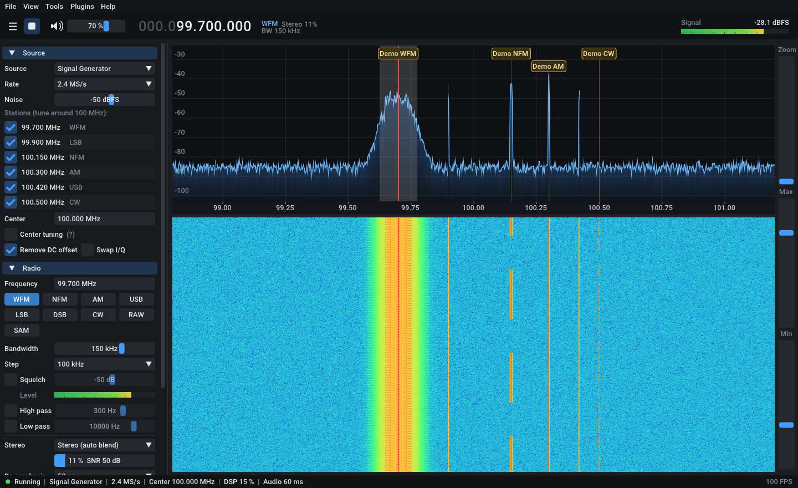

# SharkSDR

C++17 と [Dear ImGui](https://github.com/ocornut/imgui) で作った、クロスプラットフォーム（Windows / Linux / macOS）の SDR 受信アプリケーションです。
SDR++ や SDR# のような定番レイアウト（左にサイドバー、右にスペクトラムとウォーターフォール、上部に大きな周波数表示）を採用し、
ソース・復調モード・パネル・ツールなどをすべて **プラグイン（共有ライブラリ）** として後から追加できます。



## 主な機能

| 分類 | 内容 |
|---|---|
| 表示 | FFT スペクトラム（平滑化・ピークホールド・塗りつぶし）、ウォーターフォール（Turbo / Classic / Viridis / Inferno / Grayscale）、ズーム・パン、dB レンジ調整、自動レンジ |
| 選局 | 桁ごとにホイール／クリックで変更できる周波数ダイヤル、スペクトラムのクリック／ドラッグ選局、ホイールでステップ選局、帯域端ドラッグで帯域幅変更、センターチューニング、直接入力（`145.5M` など） |
| 復調 | WFM（ステレオデコーダ＋受信状態に応じた自動ステレオ／モノラルブレンド、ディエンファシス 50/75 µs）、NFM、AM、USB、LSB、DSB、CW（BFO 可変）、RAW、＋プラグインの SAM（同期 AM） |
| 受信処理 | NCO → ハーフバンドの多段 1/2 間引き → 多相リサンプラ → チャンネルフィルタ → スケルチ → 復調 → オーディオ LPF/リサンプル、AGC、DC 除去、I/Q 入れ替え |
| ノイズ対策 | FM の IF ノイズリダクション（キャリア追従型、弱い局で SINAD +7〜9 dB）、モードごとのハイパス／ローパス（8 次バターワース、CTCSS 除去や FM の高域ヒス低減に） |
| オーディオ | miniaudio による出力（WASAPI / CoreAudio / ALSA / PulseAudio 等）、デバイス選択、音量・ミュート |
| ソース（プラグイン） | 信号発生器（デモ用の仮想バンド）、IQ ファイル再生（WAV / cu8 / cs8 / cs16 / cf32）、rtl_tcp、SoapySDR*、RTL-SDR ネイティブ* |
| ツール（プラグイン） | 録音（オーディオ／ベースバンド IQ を WAV 保存）、ブックマーク（スペクトラム上にマーカー表示）、テンプレート用の Hello Example |
| その他 | 設定の自動保存（JSON）、プラグインマネージャ（実行中に有効／無効を切替）、ログウィンドウ、ダーク／ライトテーマ、UI 拡大率、日本語フォント自動マージ |

\* SoapySDR / librtlsdr がビルド環境で見つかった場合のみビルドされます。

## ビルド

必要なもの: CMake 3.20 以上、C++17 コンパイラ、Git（依存ライブラリは CMake の FetchContent で自動取得されます: GLFW 3.4、Dear ImGui 1.92.9b、miniaudio 0.11.25、nlohmann/json 3.12.0）。

### Windows（Visual Studio 2022）

「x64 Native Tools Command Prompt for VS 2022」から:

```bat
cmake --preset release
cmake --build --preset release
build\bin\SharkSDR.exe
```

Visual Studio のソリューションが欲しい場合は `cmake --preset vs2022` を使ってください。

### Linux（Ubuntu / Debian）

```sh
sudo apt install build-essential cmake ninja-build libgl1-mesa-dev xorg-dev \
                 libwayland-dev libxkbcommon-dev wayland-protocols
# 任意: ハードウェアプラグイン用
sudo apt install libsoapysdr-dev librtlsdr-dev

cmake --preset release
cmake --build --preset release
./build/bin/SharkSDR
```

Wayland の開発パッケージを入れたくない場合は `-DSHARKSDR_GLFW_WAYLAND=OFF` を付けると X11 のみでビルドします。

### macOS

```sh
brew install cmake ninja
# 任意: brew install soapysdr librtlsdr
cmake --preset release
cmake --build --preset release
./build/bin/SharkSDR
```

ビルド結果は `build/bin/` にまとまり、このフォルダごとコピーすればどこでも動きます。

```
build/bin/
├── SharkSDR(.exe)            アプリ本体（薄いラッパ）
├── SharkSDR_core(.dll/.so)   コアライブラリ（ImGui・DSP・プラグイン API・UI）
├── plugins/                  プラグイン（起動時に自動で読み込み）
└── resources/fonts/          フォント
```

### テスト

DSP チェーンをヘッドレスで検証するテストがあります（各復調モードの出力トーン、WFM ステレオ分離、SSB の逆サイドバンド抑圧、スケルチ、WAV 入出力など）。

```sh
ctest --preset release
```

GUI を伴う開発者向けのセルフテストもあります（実際のマウスは使わず、ImGui に入力を注入します）:

```sh
# クリック選局・ホイール選局・Ctrl+ホイールでズーム・帯域端ドラッグ・右ドラッグでパン・
# スライダーへの数値入力（Enter で確定 / Esc で取り消し、縦スライダーも）を検証し、
# その間 Ctrl+R で約 1 秒録音する（失敗時は終了コード 2）
SharkSDR --config <一時フォルダ> --autostart --test-ui --screenshot ui.png --frames 220
# 受信中に全プラグインをアンロード → 再ロード
SharkSDR --config <一時フォルダ> --autostart --test-plugin-reload --screenshot reload.png --frames 600
```

## 使い方

初回起動時は **Signal Generator**（100 MHz 付近に WFM ステレオ・NFM・AM・USB・LSB・CW の局がある仮想バンド）が選ばれるので、
ハードウェアがなくても ▶ ボタン（または Space キー）ですぐに試せます。サイドバーの局一覧の周波数をクリックするとその局に合わせます。

| 操作 | 動作 |
|---|---|
| スペクトラム／ウォーターフォールをクリック・ドラッグ | VFO を移動 |
| スペクトラム上で VFO 帯域の端をドラッグ | 帯域幅を変更 |
| スペクトラム上でホイール | 1 ステップ選局 |
| Ctrl + ホイール | カーソル位置を中心にズーム |
| 右／中ボタンドラッグ | ズーム中の表示をパン |
| 周波数ダイヤルの桁の上でホイール／上半分・下半分をクリック | その桁を増減（右クリックで下位桁を 0 に） |
| スライダーをダブルクリック（または Ctrl+クリック） | 数値を直接入力（Enter で確定、Esc で取り消し。`12.5k` や `-40 dB` のように単位付きでも可） |
| Space / ← → / M | 開始・停止 / ステップ選局 / ミュート |
| Ctrl+S / Ctrl+Q | 設定保存 / 終了 |
| Ctrl+R | 録音の開始・停止（Recorder プラグイン） |

macOS では Ctrl の代わりに Cmd を使います。

### ハードウェア

- **rtl_tcp**（全 OS、ドライバのリンク不要）: RTL-SDR を挿した PC で `rtl_tcp -a 0.0.0.0` を起動し、ソースで「RTL-TCP」を選んでホスト名を入力します。
- **SoapySDR**: SoapySDR とデバイス用モジュール（SoapyRTLSDR、SoapyHackRF、SoapyAirspy、SoapySDRPlay3 など）をインストールしてからビルドすると「SoapySDR」ソースが使えます。
  Windows では [PothosSDR](https://downloads.myriadrf.org/builds/PothosSDR/) 等で入れた SoapySDR の `CMAKE_PREFIX_PATH` を指定してください。
- **RTL-SDR ネイティブ**: librtlsdr が見つかると「RTL-SDR」ソースがビルドされます。

ベンダー DLL（`SoapySDR.dll` など）はプラグインと同じ `plugins/` フォルダに置いても読み込まれます。

### コマンドラインオプション

```
--config DIR       設定フォルダを指定（既定: ユーザーごとの設定フォルダ）
--plugins DIR      追加のプラグインフォルダ
--no-plugins       プラグインを読み込まない
--autostart        起動直後に受信開始
--screenshot FILE  --frames N フレーム後にウィンドウを PNG 保存して終了（ドキュメント／検証用）
```

設定は Windows: `%APPDATA%\SharkSDR`、macOS: `~/Library/Application Support/SharkSDR`、Linux: `~/.config/SharkSDR` に保存されます。
実行ファイルと同じフォルダに `portable` という名前のファイルを置くと、そのフォルダに保存するポータブルモードになります。

## プラグインで拡張する

拡張ポイントは「ソース」「復調モード」「サイドバーのパネル」「Tools メニュー」「独自ウィンドウ」「スペクトラム上のオーバーレイ」「IQ／オーディオのタップ」です。
最小のプラグインはこれだけです:

```cpp
#include <SharkSDR/plugin.h>

class MyPlugin : public SharkSDR::Plugin {
public:
    void init(SharkSDR::Host& host) override {
        host.registerPanel("My panel", [&host] {
            ImGui::Text("VFO: %.0f Hz", host.frequency());
            if (ImGui::Button("Go to 145 MHz")) host.setFrequency(145e6);
        });
    }
};

SHARKSDR_PLUGIN(MyPlugin, "My plugin", "0.1.0", "Me", "Example")
```

```cmake
sharksdr_add_plugin(my_plugin SOURCES my_plugin.cpp)
```

リポジトリの外に置いたプラグインも `-DSHARKSDR_EXTRA_PLUGINS=/path/to/my_plugin` で一緒にビルドできます。
詳しくは **[docs/PLUGIN_GUIDE.md](docs/PLUGIN_GUIDE.md)** を参照してください。同梱プラグイン（`plugins/`）もそのままサンプルとして読めます。

## ソース構成

```
core/include/SharkSDR/   公開 API（plugin.h, host.h, source.h, demodulator.h, dsp/*, ui/*, util/*）
core/src/dsp/         FFT・FIR 設計・リサンプラ・受信チェーン・組み込み復調器
core/src/ui/          テーマ・ウィジェット（周波数ダイヤル、ファイル選択など）
core/src/app/         アプリ本体（エンジン/DSP スレッド、スペクトラム表示、プラグイン管理、レイアウト）
app/                  main()
plugins/              同梱プラグイン
tests/                DSP テスト
```

スレッド構成: UI スレッド（ImGui）／ソースのストリーミングスレッド → ロックフリーのリングバッファ → DSP スレッド（FFT・受信チェーン・タップ） → オーディオコールバック。

## 動作確認の状況

- Windows 11 + MSVC 19.44（VS 2022）: Release / Debug ビルド（警告なし、Debug で ImGui のアサートなし）、DSP テスト全項目合格、UI セルフテスト合格、信号発生器・IQ ファイル再生・rtl_tcp（擬似サーバ）での受信、実行中のプラグインのアンロード／再ロード、設定の保存と復元を確認済み。SoapySDR / RTL-SDR プラグインはライブラリに対するビルドとロードまで確認（実機なし）。音声出力はバッファ状態で確認しており、実際の音質は耳では確認していません。
- Linux / macOS: 移植性を考慮して実装し、`.github/workflows/build.yml` で 3 OS をビルド・テストする CI を用意していますが、この環境では実行していません。

## サードパーティ

Dear ImGui（MIT）、GLFW（zlib）、miniaudio（MIT-0 / Public Domain）、nlohmann/json（MIT）、Roboto / Cousine フォント（Apache 2.0）。

## ライセンス

[MIT License](LICENSE) です。サードパーティのライブラリとフォントには、それぞれのライセンスが適用されます。
